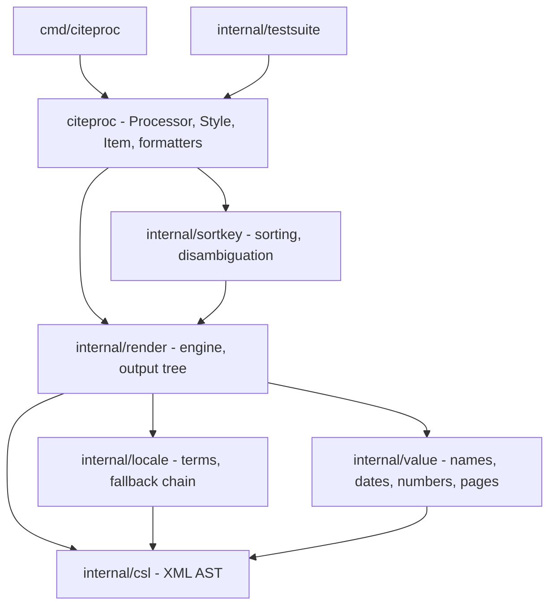
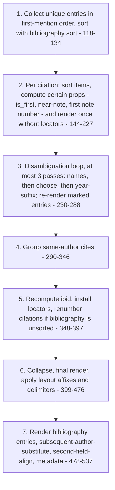

# Port map: hayagriva → citeproc (Go)

Status: day-1 deliverable of the spike (`plan.md` §5, day 1).

This document maps every module of the Rust crate
[hayagriva](https://github.com/typst/hayagriva) that matters for CSL
processing, plus the parts of
[citationberg](https://github.com/typst/citationberg) it calls, to the Go
package that will hold the port. It also records hayagriva behaviour that we
deliberately **do not** copy, and what each choice means for APA.

## 0. Pinned sources

| Crate | Version | Commit | Read from |
|---|---|---|---|
| hayagriva | 0.10.1 | `e51299ecd1a9f62b2f069af2f554ae4e84d50527` | `~/.cargo/registry/src/index.crates.io-*/hayagriva-0.10.1` |
| citationberg | 0.7.0 | `25c66d5f79d919fb8446ef33075a70977066e82c` | `~/.cargo/registry/src/index.crates.io-*/citationberg-0.7.0` |

All `file:line` references below are against these versions. hayagriva paths
are relative to `hayagriva-0.10.1/src/`. citationberg paths are written as
`cb:<file>:<line>` (relative to `citationberg-0.7.0/src/`).

**Port rule (from `plan.md` §2):** port structure and algorithms, not code
line by line. Every Go file that ports hayagriva logic starts with a comment
naming its source, for example:

```go
// Ported from hayagriva 0.10.1 src/csl/rendering/names.rs (add_names, write_name).
```

## 1. Source inventory

| hayagriva file | Lines | Role | Go destination |
|---|---:|---|---|
| `csl/mod.rs` | 3921 | Driver (`BibliographyDriver::finish`), disambiguation, collapsing, subsequent-author-substitute, `Context`/`WritingContext`, public request/result types | `citeproc`, `internal/render`, `internal/sortkey` |
| `csl/rendering/mod.rs` | 1464 | `RenderCsl` for text, number, label, date, choose, group, layout | `internal/render` |
| `csl/rendering/names.rs` | 868 | `cs:names`/`cs:name`, et-al, substitute, name-disambiguation forms | `internal/render` |
| `csl/sort.rs` | 217 | Sort keys and comparison | `internal/sortkey` |
| `csl/taxonomy.rs` | 939 | `EntryLike` trait; variable resolution for hayagriva `Entry` **and** CSL-JSON `Item` | `internal/render` (interface) + `citeproc` (CSL-JSON adapter) |
| `csl/elem.rs` | 632 | Output tree (`Elem`, `ElemChild`, `ElemMeta`), built-in writers | `internal/render` (tree) + `citeproc` (formatters) |
| `csl/citation_label.rs` | 129 | Alphanumeric label generator (hayagriva `Entry` only) | not ported (optional later) |
| `csl/archive.rs` | 1210 | Generated CBOR archive of 80 styles / 63 locales | replaced by `citeproc/embed.go` |
| `lang/mod.rs`, `lang/en.rs`, `lang/name.rs` | 1088 / 483 / 117 | Case folding (title/sentence case), English word lists, name particles, `is_cjk` | `internal/render` (text case), `internal/value` (particles, CJK) |
| `types/numeric.rs` | 511 | `Numeric` (numbers, sets, affixes) | `internal/value` |
| `types/page.rs` | 440 | `PageRanges` | `internal/value` |
| `types/persons.rs` | 674 | `Person` (initials, particles, sorting) | `internal/value` |
| `types/time.rs` | 789 | `Date`, `Duration` | `internal/value` (`Date` only) |
| `types/strings.rs` | 683 | `FormatString`, `ChunkedString` (`{verbatim}`/`$math$` markup) | concept only → `internal/render` rich text |
| `types/mod.rs` | 666 | `EntryType`, `MaybeTyped<T>`, `QualifiedUrl`, `Publisher`, `SerialNumber` | `internal/value` (`MaybeTyped` idea only) |
| `lib.rs` | 1042 | `Library`, `Entry`, re-exports | API shape only |
| `interop.rs`, `io.rs`, `selectors/`, `util.rs`, `main.rs` | 869 / 158 / 685 / 187 / 487 | BibLaTeX, YAML, selector DSL, serde helpers, clap CLI | not ported (`main.rs` → `cmd/citeproc`, rewritten) |
| `tests/citeproc.rs`, `tests/common/mod.rs`, `tests/citeproc-pass.txt`, `tests/local/*.txt` | 1041 / 97 / 511 entries / 17 files | CSL test-suite harness and ratchet | `internal/testsuite`, `testdata/` |

| citationberg file | Lines | Role | Go destination |
|---|---:|---|---|
| `lib.rs` | 3928 | CSL 1.0.2 AST for styles **and** locales, settings, `PageRangeFormat::format`, `LocaleCode` fallback, `OrdinalLookup`, `TermForm::fallback` | `internal/csl`, `internal/locale`, `internal/value` (page-range algorithm) |
| `taxonomy.rs` | 1526 | `Variable`, `Kind`, `Term`, `OtherTerm`, `Locator`, `Season` | `internal/csl` |
| `json.rs` | 640 | CSL-JSON `Item`, names, dates (`date-parts`, `raw`, `circa`, `season`), citation items | `citeproc` (model) + `internal/value` (date parsing) |
| `util.rs` | 72 | Lenient bool/u32 deserialisers | `internal/csl` (attribute helpers) |

## 2. Go package layout and dependencies

`plan.md` §3 fixes the package set. The port adds one constraint: **imports
must flow one way**. Rust can put `impl RenderCsl for citationberg::Text` in
hayagriva, but Go can't add methods to another package's types. The engine
therefore uses functions with a type switch over `csl.Element`.



How the Rust abstractions translate to Go:

| Rust construct | Go replacement |
|---|---|
| `trait RenderCsl` implemented on citationberg types (`rendering/mod.rs:30`) | `render.renderElem(ctx, csl.Element)`, `willRender`, `willHaveInfo`: one `switch el := el.(type)` each |
| `trait EntryLike` (`csl/taxonomy.rs:22`) with generic `T: EntryLike` everywhere | `render.Entry` interface. The root package implements it with an adapter over `citeproc.Item`, so `render` never imports the root (no cycle) |
| Output tree in `elem.rs`, re-exported publicly by `lib.rs:154-162` | Tree types live in `internal/render`. Root `output.go` re-exports them with type aliases (`type Node = render.Node`), so goldmark can walk the tree without importing an internal package |
| Lifetimes `'a` on requests and results | Gone. Results hold copies or indices |
| `MaybeTyped<T>` (`types/mod.rs:311`) | `struct{ Parsed *T; Raw string }` |
| `NonEmptyStack<T>` (`elem.rs:542`) | Generic `stack[T]` in `internal/render` |
| `Cow<'_, T>` | Plain values or pointers |
| `thiserror` enums | Sentinel errors plus `*csl.ParseError{Line, Col, Element, Msg}`, collected in `csl.ErrorList` |

**Style vs locale AST.** citationberg parses inline `<locale>` elements in a
style and standalone locale files with the same types (`cb:lib.rs`, `Locale`
and `LocaleFile`). We do the same: `internal/csl` owns the locale AST and its
XML decoding. `internal/locale` owns loading, merging and lookup.

## 3. citationberg → `internal/csl` and `internal/locale`

### 3.1 How hayagriva calls citationberg

- **Parsing.** `Style::from_xml` / `LocaleFile::from_xml` use serde-derived
  structs over `quick_xml::de` (`cb:lib.rs:486-490`), with
  `serde_path_to_error` for error paths (`cb:lib.rs:274-281`).
  - Attributes are `@name` fields.
  - Ordered mixed children (rendering elements inside `layout`, `group`,
    `if`, …) are `$value` enums.
  - Booleans accept `"true"` case-insensitively (`cb:util.rs:3-35`).
- **At runtime** hayagriva does **not** parse XML. It decodes CBOR from
  `csl/archive.rs`. The `tests/citeproc.rs` harness is the exception: it parses
  fixture CSL with `Style::from_xml`.
- **API surface used.** These are rough counts of identifier occurrences in
  `src/csl` + `src/types`. They show which AST parts get the most traffic:

| Group | Types (≈ uses) | Main users |
|---|---|---|
| Taxonomy | `StandardVariable` 83, `Variable` 75, `Kind` 70, `NameVariable` 56, `NumberVariable` 48, `LocaleCode` 47, `Term` 24, `DateVariable` 22, `Locator` 20, `OtherTerm` 20, `PageVariable` 17, `NumberOrPageVariable` 16 | everywhere |
| Rendering AST | `Number` 63, `Text` 35, `LayoutRenderingElement` 31, `Names` 21, `Name` 19, `TextTarget` 18, `Choose` 13, `TextCase` 13, `Group` 10, `Date`/`DatePart`/forms, `Label`, `Layout` | `rendering/*` |
| Name options | `InheritableNameOptions`, `NameOptions`, `NameAnd`, `DelimiterBehavior`, `NameAsSortOrder`, `NameForm`, `NameLabelPosition`, `DemoteNonDroppingParticle` | `rendering/names.rs`, `sort.rs` |
| Style root | `Style`/`IndependentStyle`, `Citation`, `Bibliography`, `CslMacro`, `Sort`/`SortKey`/`SortDirection`, `Collapse`, `DisambiguationRule`, `SubsequentAuthorSubstituteRule`, `SecondFieldAlign`, `StyleClass`, `CitationFormat` | `csl/mod.rs`, `sort.rs` |
| Formatting | `Formatting` + 5 enums, `Affixes`, `Display`, `ToFormatting`, `ToAffixes` | `elem.rs`, rendering |
| Locale | `Locale`, `LocaleFile`, `TermForm` 22, `OrdinalLookup`, `GrammarGender`, `BaseLanguage` | `csl/mod.rs`, `types/numeric.rs` |
| Algorithms | `PageRangeFormat::format`, `NameOptions::is_suppressed`, `InheritableNameOptions::apply`, `Names::from_names_substitute`, `ChooseMatch::test`, `TermForm::fallback`, `LocaleCode::fallback` | rendering, driver |
| CSL-JSON (`json` feature) | `json::Item`, `Value`, `NameValue`, `NameItem`, `DateValue`, `FixedDateRange`, `CitationItem` | `csl/taxonomy.rs`, tests |

### 3.2 Mapping

| citationberg item | Go package | Go file / identifier | Notes |
|---|---|---|---|
| `Style`, `RawStyle` validation (`cb:lib.rs:429-463`), `IndependentStyleSettings` (`cb:lib.rs:494-519`), `StyleInfo` | `internal/csl` | `style.go`: `Style`, `Info`, `Settings` | Dependent styles: parse `<link rel="independent-parent">`; resolving them is the root package's job |
| `Citation` (`cb:lib.rs:1082`), `Bibliography` (`cb:lib.rs:1244`), `Sort`, `SortKey`, `Layout`, `CslMacro` | `internal/csl` | `style.go`: `Citation`, `Bibliography`, `Sort`, `SortKey`, `Layout`, `Macro` | Keep the delimiter helpers `get_year_suffix_delimiter` / `get_after_collapse_delimiter` (`cb:lib.rs:1172-1185`), which follow the spec; hayagriva's driver ignores them (see §9) |
| `LayoutRenderingElement`, `RenderingElement`, `Text`/`TextTarget`, `Number`, `Label`, `Date`/`DatePart`, `Names`/`Name`/`NamePart`/`EtAl`/`Substitute`, `Group`, `Choose`/`ChooseBranch` | `internal/csl` | `element.go`: `Element` interface + one struct per element | Ordered children via a custom `UnmarshalXML` token walk (replaces serde `$value`) |
| `InheritableNameOptions::apply` (`cb:lib.rs:2512`), `NameOptions::is_suppressed` (`cb:lib.rs:2556`), `Name::options` (`cb:lib.rs:2348`), `Names::{options, delimiter, label, from_names_substitute}` (`cb:lib.rs:2162-2228`) | `internal/csl` | `names.go` | Name-option cascade (style → citation/bibliography → `cs:names` → `cs:name`). See the `Names::delimiter` quirk in §9 |
| `ChooseMatch::test` (`cb:lib.rs:2972`) | `internal/csl` | `choose.go`: `(Match) Test([]bool) bool` | |
| `Formatting` + enums, `Affixes`, `Display`, `TextCase` (`is_language_independent` `cb:lib.rs:3549`) | `internal/csl` | `formatting.go` | |
| `PageRangeFormat` enum | `internal/csl` | `formatting.go` | Enum only; the algorithm goes to `internal/value` |
| `PageRangeFormat::format` (`cb:lib.rs:706-829`) | `internal/value` | `pages.go`: `FormatPageRange(f, start, end, sep)` | Pandoc-derived; chicago-15/16, expanded, minimal, minimal-two. APA uses `expanded` |
| `taxonomy.rs`: `Variable` (+`Display` names, `cb:taxonomy.rs:196-577`), `Kind` (`cb:taxonomy.rs:677-903`), `Term`, `OtherTerm`, `Locator` (`cb:taxonomy.rs:906-997`), `Season` (`cb:taxonomy.rs:1475-1525`), `Term::is_lexically_same` (`cb:taxonomy.rs:644-675`) | `internal/csl` | `taxonomy.go`: string-backed enums + lookup tables | Keep exact CSL spellings (`DOI`, `URL`, `legal_case`, …). Check citationberg's `archive_place` spelling against the CSL-JSON schema |
| `Locale`, `LocaleFile`, `LocalizedTerm`, `TermForm`, `LocaleOptions`, `OrdinalMatch`, `GrammarGender` | `internal/csl` | `locale.go` | Shared by inline style locales and locale files |
| `Locale::term` (`cb:lib.rs:3066`), `TermForm::fallback` (`cb:lib.rs:3316-3343`) | `internal/locale` | `terms.go`: `(*Chain) Term(term, form, plural)` | Form fallback is the **outer** loop over the whole locale chain (`csl/mod.rs:3020-3040`) |
| `OrdinalLookup` (`cb:lib.rs:3087-3210`) | `internal/locale` | `ordinal.go` | Includes legacy `ordinal-01..04` handling |
| `LocaleCode::{parse_base, fallback, is_english}` (`cb:lib.rs:537-646`) | `internal/locale` | `code.go`: `BaseLang`, `PrimaryDialect` (static table), `IsEnglish` | |
| `util::deserialize_bool/u32` | `internal/csl` | `decode.go`: `parseBool`, `parseUint` | |
| `XmlDeError` + `serde_path_to_error` | `internal/csl` | `errors.go`: `ParseError{Line, Col, Element, Msg}`, `ErrorList` | `plan.md` asks for line/column. All fatal errors are collected, not just the first |
| `json::Item`, `Value`, `NameValue`/`NameItem` (`cb:json.rs:17-113`) | `citeproc` | `item.go`: `Item`, `Name`, `UnmarshalJSON` | Keep number/string duality and numeric IDs (`cb:json.rs:21-23, 57-63`) |
| `DateValue`, `VecDate`, `FixedDate(Range)`, `parse_date`, BooleanLike `circa` (`cb:json.rs:117-466`) | `citeproc` + `internal/value` | `citeproc.Date` (JSON shape) → `value.ParseDate` → `value.Date{Start, End, Circa, Season, Literal}` | Support ranges and `literal` (hayagriva doesn't; see §9). Use **1-based** months in Go; citationberg stores 0-based (`cb:json.rs:395-397`) |
| `json::CitationItem`, `Citation` (`cb:json.rs:471-548`) | `citeproc` | `citation.go`: `Citation`, `CitationItem` | Same fields as the CSL-JSON citation item: `id`, `locator`, `label`, `prefix`, `suffix`, `suppress-author`, `author-only`, `position`, `near-note` |

## 4. `csl/mod.rs` (driver) → `citeproc`, `internal/render`, `internal/sortkey`

### 4.1 Pipeline of `BibliographyDriver::finish` (`csl/mod.rs:114-538`)

This is the two-phase design `plan.md` §3 asks for. `citation()` (`:103`) only
records a request and stamps `initial_idx`; all work happens in `finish`.



**Certain vs speculative state** (`csl/mod.rs:2513-2615`). Port this split
as-is, because it explains why some values can't be known on the first render:

- `CertainCiteProperties`: `note_number`, `first_note_number`,
  `is_near_note`, `is_first`, `initial_idx`. These depend only on insertion
  order.
- `SpeculativeCiteProperties`: `locator` (kept `None` until step 5 so it can't
  affect disambiguation, `:2565-2568`), `citation_number`, `ibid`,
  `disambiguation`, `identifier_usage`. These depend on rendering or the final
  order.

### 4.2 Mapping

| hayagriva item | Go package | Go file / identifier | Notes |
|---|---|---|---|
| `BibliographyDriver` (`:49-108`), `with_citation_number_offset` (`:97`) | `citeproc` | `processor.go`: `Processor`, `Options.CitationNumberOffset` | One `Processor` per document; it holds the `*Style` (immutable, shared) |
| `citation()` (`:103`) | `citeproc` | `(*Processor).Cite(Citation) CiteRef` | Records only. The returned handle indexes into the finished results |
| `finish()` (`:114-538`) | `citeproc` | `finish.go`: `(*Processor).finish()` | Called lazily by `Bibliography()` / `Citations()`; memoised and invalidated by new `Cite` calls |
| `SpeculativeItemRender`, `SpeculativeCiteRender` (`:63-82`) | `internal/render` | `pass.go`: `ItemRender`, `CiteRender` | Per-item working state across passes |
| `CiteProperties`, `CertainCiteProperties`, `SpeculativeCiteProperties` (`:2513-2615`) | `internal/render` | `props.go`: `CiteProps{Certain, Spec}` | |
| `IbidState` + `with_last` (`:2692-2729`) | `internal/render` | `position.go`: `Ibid`, `computeIbid` | APA doesn't test position; low priority |
| `DisambiguateState` (`:2650-2689`) | `internal/sortkey` | `disamb.go`: `DisambState` with `Max` | State order: None → NameDisambiguation → Choose → YearSuffix |
| `find_ambiguous_sets` (`:1090-1147`) | `internal/sortkey` | `disamb.go`: `findAmbiguous` | Compare the **plain-text** rendering, not hayagriva's VT100 string (`:1116`) |
| `disambiguate_names`, `is_disambiguated`, `disamb_cite_add_given_name`, `get_names` (`:733-997`) | `internal/sortkey` | `disamb_names.go` | Implement all `givenname-disambiguation-rule` values (§9) |
| `disambiguate_with_choose` (`:1000-1030`) | `internal/sortkey` | `disamb.go`: `markChoose` | |
| `disambiguate_year_suffix` (`:1033-1086`) | `internal/sortkey` | `yearsuffix.go`: `assignYearSuffixes` | Assign in **bibliography** order (§9) |
| Cite grouping (`:290-346`) | `internal/render` | `citegroup.go`: `groupCites` | Group key = rendered names text, not Debug output (§9) |
| `collapse_items`, `CollapseVerdict` (`:1149-1283`, `:1484`) | `internal/render` | `collapse.go` | APA uses `collapse="year"` |
| `substitute_subsequent_authors` (`:1286-1482`) | `internal/render` | `subsequent.go` | Tree rewrite keyed on `Names`/`Name` meta. APA doesn't use it; MLA does |
| `do_rerender`, `last_purpose_render` (`:629-642`, `:710-727`) | `internal/render` | `engine.go` | |
| `date_replacement`, `write_year` (`:644-707`) | `internal/render` | `date.go`: `yearOnly`, `writeYear` | |
| `standalone_citation` (`:543-627`) | `citeproc` | `standalone.go`: `(*Style).CiteStandalone` (optional) | One-shot; no disambiguation. Not needed for the spike |
| `StyleContext` + `ctx`, `citation`, `bibliography`, `do_citation` (`:1698-1874`), `do_bibliography` (`:1877-1896`), `get_macro` | `internal/render` | `style.go`: `StyleCtx`, `RenderCitationItem`, `RenderBibEntry` | `do_author` (`:1735-1800`) is the author-only fallback chain |
| `lookup_locale`, `locale()`, `punctuation_in_quotes` (`:1899-1904`, `:2091-2145`) | `internal/locale` | `chain.go`: `Chain` | Order: style locales (exact → base language → untagged) → locale files (exact → primary dialect → `en-US`) |
| `InstanceContext` (`:1553-1600`), `Sorting` (`:1546`), `SpecialForm` (`:3397-3406`) | `internal/render` | `context.go`: `Instance`, `SortMode`, `SpecialForm` | `SpecialForm` covers author-only, suppress-author, collapsed date/year-suffix |
| `Context` (`:2505`, `:2779-3296`) | `internal/render` | `context.go`: `Context` | Variable resolution, terms, special forms |
| `WritingContext` (`:2151-2503`) | `internal/render` | `writer.go`: `Writer` | Element, format, case, delimiter and name-option stacks. `push_str` rules (`:2908-2966`) — punctuation pull-in, affix dedup, strip-periods — belong here, not in post-processing (`plan.md` §6) |
| `push_quotes`/`pop_quotes` (`:2821-2860`), `do_pull_punctuation` (`:2861`) | `internal/render` | `writer.go` | Punctuation-in-quote |
| `UsageInfo` (`:3323-3349`) | `internal/render` | `usage.go`: `usageInfo`, `shouldRenderGroup` | Core of implicit group suppression |
| `IdentifierUsage` (`:2619-2647`) | not ported | — | hayagriva extension (citation-number ↔ citation-label swap) |
| `CitationRequest` (`:1909-1982`), `BibliographyRequest` (`:1985-2013`) | `citeproc` | `citation.go`: `Citation{Items, NoteNumber}`; style and locale move to `NewProcessor(style, Options{Locale})` | One style per processor |
| `CitationItem` (`:2017-2081`) | `citeproc` | `citation.go`: `CitationItem{ID, Locator, Label, Prefix, Suffix, SuppressAuthor, AuthorOnly, …}` | Add prefix/suffix and suppress-author, which hayagriva lacks |
| `SpecificLocator`, `LocatorPayload`, `TransparentLocator` (`:2734-2777`) | `citeproc` | `Locator string` + `Label string` (→ `csl.Locator`) | Transparent locators are a Typst feature; not ported |
| `CitePurpose` (`:3383-3393`) | `citeproc` | `CiteMode` (`Normal`, `AuthorOnly`, `SuppressAuthor`, `Composite`, `Full`, `YearOnly`) | |
| `Rendered`, `RenderedCitation` (`:1493-1543`) | `citeproc` | `result.go`: `RenderedCitation{NoteNumber, Node}` | |
| `RenderedBibliography`, `BibliographyItem` (`:1502-1534`) | `citeproc` | `bibliography.go`: `Bibliography{Meta, Entries}`, `Entry{ID, FirstField, Node}` | `Meta` = hanging-indent, second-field-align, line-spacing, entry-spacing (APA: `true`, –, `2`, `0`) |
| `Brackets` (`:3352-3378`) | not ported | — | Re-exported but unused by the engine |

## 5. `csl/rendering/` → `internal/render`

| hayagriva item | Go file / identifier | CSL semantics |
|---|---|---|
| `trait RenderCsl` (`rendering/mod.rs:30-37`), impls for `LayoutRenderingElement` (`:1341`) and `RenderingElement` (`:1430`) | `element.go`: `renderElem`, `willRender`, `willHaveInfo` | Dispatch |
| `impl Text`, `ResolvedTextTarget` (`:39-321`) | `text.go`: `renderText`, `resolveTextTarget` | Variable/macro/term/value. DOI/PMID/PMCID URL prefixes and links (`:58-110`). Macros render as implicit groups without inheriting the delimiter (`:126-136`) |
| `impl Number`, `render_typed_num`, `render_page_range` (`:323-473`) | `number.go`: `renderNumber`, `renderPageRange` | Ordinal, long-ordinal, roman. Page ranges use the `page-range-delimiter` term (default `–`) |
| `label_pluralization`, `impl Label`, `render_label_with_var` (`:475-622`) | `label.go` | `plural="contextual"` uses `Numeric::is_plural` / `PageRanges::is_plural` |
| `impl Date`, `render_date_part`, `render_year_suffix_implicitly` (`:624-951`) | `date.go`: `renderDate`, `renderDatePart`, `renderYearSuffixImplicitly`, `dateSortKey` | Localized dates merge locale parts with style overrides (`:706-763`). Implicit year-suffix after the first year (`:942-951`). **Date ranges are a TODO in hayagriva (`:720`)** |
| `choose_children`, `impl Choose`, `BranchConditionIter` (`:953-1290`) | `choose.go`: `selectBranch`, `evalConditions(ctx, *csl.Branch) []bool` | One bool per value per attribute, then `match` all/any/none |
| `render_with_delimiter` (`:1011-1046`) | `group.go`: `renderWithDelimiter` | |
| `impl Group` (`:1292-1339`), `impl Layout` (`:1401-1428`) | `group.go`: `renderGroup`; `layout.go`: `RenderLayout` | Groups render first and are discarded if `!shouldRenderGroup` |
| `From<TextCase> for Case` (`:1453-1464`) | `textcase.go`: `caseFor` | |
| `DisambiguatedNameForm`, `NameDisambiguationProperties` (`names.rs:20-146`) | `namedisamb.go`: `NameForm`, `NameDisambProps{Forms [][]*NameForm, Default, Vars}`, `AddName`, `Max`, `FormAt` | Rendered by `render`, mutated by `sortkey` |
| `renders_given_special_form` (`names.rs:148-186`) | `names.go`: `namesAllowedInSpecialForm` | Author-only / suppress-author |
| `impl Names` (`names.rs:188-473`) | `names.go`: `renderNames`, `namesWillRender`, `namesWillHaveInfo` | editor+translator merge (`:192-223`), substitute with variable suppression (`:242-270`), `form="count"` (`:275-306`) |
| `add_names`, `EndDelim` (`names.rs:476-611`) | `names.go`: `renderNameList` | et-al, et-al-use-last, `and`, delimiter-precedes-last/et-al. APA bibliography uses `et-al-use-last` (21+ authors) |
| `write_name` + helpers (`names.rs:613-868`) | `name.go`: `writeName`, `writeInverted`, `writeSimple` | `name-as-sort-order`, initials, particle demotion, name-part formatting |

**Interface the engine needs.** The rendering code only reaches outside its
own files through the `Context` methods listed below. That makes them the
contract for `internal/render`'s `Context` and `Writer`:

- Output: `push_elem`, `commit_elem`, `discard_elem`, `push_format`/`pop_format`,
  `apply_prefix`/`apply_suffix`, `push_str`, `push_chunked`, `push_link`,
  `ensure_space`, `push_quotes`/`pop_quotes`, `may_pull_punctuation`,
  `may_strip_periods`, `push_case`/`pop_case`, `push_delimiter`/`pop_delimiter`,
  `push_name_options`/`pop_name_options`, suppression toggles, `len`.
- Lookup: `term`, `gender`, `ordinal_lookup`, `localized_date`,
  `resolve_{standard,number,page,number_or_page,date,name}_variable`
  (all honour the substitute-suppression list), `get_macro`, style settings.
- State: `should_disambiguate`, `is_first_date`/`peek_is_first_date`,
  `renders_year_suffix_implicitly`, `instance.kind` (special form),
  `instance.sorting`, cite props.

## 6. `csl/sort.rs` → `internal/sortkey`

| hayagriva item | Go file / identifier | Notes |
|---|---|---|
| `StyleContext::sort` (`sort.rs:190-216`) | `sort.go`: `SortItems` | Stable sort (`sort.SliceStable`). **Precompute keys once per item** instead of re-rendering per comparison |
| `cmp_entries` (`sort.rs:53-187`) | `sort.go`: `keysFor`, `compareKeys` | Variable keys: standard (collated, lowercased), date (`Date::csl_cmp`), names, number, page. Macro keys: render with `Sorting::Macro` and apply `names-min`/`names-use-first`/`names-use-last` (`:152-159`) |
| `CollationOrd` (`sort.rs:18-49`) | `collate.go` | hayagriva builds an ICU collator **per comparison**. Build one per processor locale |
| `Date::csl_cmp` (`types/time.rs:149`) | `internal/value` `date.go`: `(Date) Compare` | |
| `Person::csl_cmp` (`types/persons.rs:505-555`) | `internal/value` `name.go`: `CompareNames` | Demote-particle rule, CJK names last |

APA's citation sort is `author-sort` (with `names-min="3"`,
`names-use-first="1"`), `date-sort-group`, `date-sort`, `status`. Its
bibliography sort adds `title`. All are macro keys except `status`, so the
macro path is the one that matters.

## 7. `csl/taxonomy.rs`, `elem.rs`, `lang/`, `archive.rs`

| hayagriva item | Go package | Go file / identifier | Notes |
|---|---|---|---|
| `trait EntryLike` (`taxonomy.rs:22-41`) | `internal/render` | `entry.go`: `Entry` interface (`Standard`, `Number`, `Page`, `Names`, `Date`, `MatchesType`, `IsEnglish`, `ID`) | |
| Processor-supplied variables in `impl InstanceContext` (`taxonomy.rs:43-108`): `citation-number`, `first-reference-note-number`, `locator`, `year-suffix` | `internal/render` | `variables.go` | |
| `letter()` (`taxonomy.rs:922-939`) | `internal/sortkey` | `yearsuffix.go`: `suffixLetter(n int)` | Bijective base 26 (`a`…`z`, `aa`, …). Use `int`, not `u8` (hayagriva wraps at 256) |
| `impl EntryLike for json::Item` (`taxonomy.rs:707-909`) | `citeproc` | `item_entry.go`: `itemEntry` implements `render.Entry` | The CSL-JSON path. Port it, fixing the gaps in §9 |
| `impl EntryLike for Entry` (`taxonomy.rs:138-705`), `csl_language` (`:911`) | not ported | — | hayagriva YAML model |
| `Elem`, `ElemChild`, `ElemChildren`, `ElemMeta`, `Formatted`, `Formatting`, `simplify_children` (`elem.rs:14-452`) | `internal/render` | `tree.go`: `Node`, `Child`, `Meta`, `Format`, `simplify` | Drop `Markup` and `Transparent` children (Typst-only). Re-export through root type aliases |
| `BufWriteFormat::Plain` (`elem.rs:390-398`) | `citeproc` | `output.go`: `PlainText` formatter | |
| `BufWriteFormat::Html` (`elem.rs:475-539`) | not ported | — | Inline-CSS spans, no escaping; not citeproc-js compatible |
| citeproc-js HTML writer in the test harness (`tests/citeproc.rs:637-824`) | `citeproc` | `output.go`: `HTML` formatter | Becomes the **production** HTML: `csl-bib-body`/`csl-entry`/`csl-left-margin`/`csl-right-inline`/`csl-indent`, `<i>`, `<b>`, `<sup>`, `<sub>`, small-caps span. **Add escaping** (`&#38;`, `&#60;`, `&#62;`) |
| `BufWriteFormat::VT100` | not ported | — | |
| `lang::CaseFolder`, `Case`, `TitleCase`, `SentenceCase`, `CharClass` (`lang/mod.rs:13-683`) | `internal/render` | `textcase.go` | Streaming case transform; title/sentence only for English items (`csl/mod.rs:3083-3100`). Port the ~20 unit tests (`lang/mod.rs:744-1088`) |
| `en::NEVER_CAPITALIZE`, `en::ALWAYS_CAPITALIZE` (`lang/en.rs`) | `internal/render` | `textcase_en.go` | Compare with the CSL spec stop-word list (§9) |
| `en::ARTICLES`, `name::NAME_PARTICLES`, `is_cjk` (`lang/mod.rs:731`) | `internal/value` | `name.go` | Use a map; the particle list has duplicates |
| `citation_label::Alphanumerical` (`citation_label.rs`) | not ported | — | Only runs for hayagriva `Entry`. CSL-JSON reads `citation-label` from the item |
| `ArchivedStyle`, `LOCALES`, `from_cbor` (`archive.rs`) | `citeproc` | `embed.go` (`//go:embed styles/*.csl locales/*.xml`), `style.go`: `LoadStyle(fs.FS, name)` | XML parsed on demand and cached. Spike question 2 measures the cost |

## 8. `src/types/` → `internal/value`

Only `Numeric`, `PageRanges`, the name helpers and `Date` carry over.
Everything YAML-shaped is dropped.

| hayagriva item | Go file / identifier | Notes |
|---|---|---|
| `MaybeTyped<T>`, `infallible_from_str` (`types/mod.rs:311-371`) | `number.go`: `Number{Parsed *Numeric, Raw string}`; `pages.go`: `Pages{Parsed *PageRanges, Raw string}` | Parsed-or-raw fallback drives `is-numeric`, label plurals and sorting |
| `Numeric`, `NumericValue`, `NumericDelimiter`, `NumericError` (`types/numeric.rs:17-471`) | `numeric.go`: `Numeric{Parts []NumPart, Prefix, Suffix}`, `ParseNumeric` | Grammar at `:244-311`: prefix, number, `,`/`&`/`-`/`–` sets, suffix keeps the first number's trailing space (`第 6 册`). Em dash is not a delimiter |
| `Numeric::with_form` (`:160-186`) | `internal/render` `number.go` | Needs locale ordinals. Roman numerals via a small hand-written helper (replaces `roman-numerals-rs`) |
| `is_plural`, `csl_cmp`, `single_number`, `nth` | `numeric.go` methods | |
| `PageRanges`, `PageRangesPart`, `group_by` (`types/page.rs:21-351`) | `pages.go`: `PageRanges`, `ParsePageRanges` | `first()` gives `page-first`. Escaped ranges `1\-4` |
| `Person` fields, `initials`, `first_name_with_delimiter`, `name_particle`, `name_without_particle`, `is_institutional`, `is_cjk`, `name_without_article` (`types/persons.rs:88-500`) | `name.go` | Prefer CSL-JSON `dropping-particle` / `non-dropping-particle`. Keep `Person::from_strings` heuristics (`:169-242`) only for names with no particle fields, as hayagriva does (`csl/taxonomy.rs:788-809`) |
| `Date` fields, `csl_cmp` (`types/time.rs:16-162`) | `date.go`: `Date{Start, End DatePart, Circa bool, Season int, Literal string}` | hayagriva's `Date` has no range or literal. Its `FromStr` grammar (`:182-237`) is YAML-only; parse CSL-JSON `raw` with citationberg's `parse_date` rules (`cb:json.rs:359-466`) instead |
| `display_year_opt` (`types/time.rs:268`) | not ported | Unused by the CSL renderer; BC/AD come from locale terms via `write_year` |
| `EntryType`, `QualifiedUrl`, `Publisher`, `SerialNumber`, `PersonRole`, `PersonsWithRoles`, `FormatString`, `ChunkedString` parser, `Duration`, `DurationRange` | not ported | YAML/BibTeX/Typst shapes. The `ChunkKind::Normal`/`Verbatim` idea becomes CSL-JSON rich text (`<i>`, `<b>`, `<sc>`, `<sup>`, `<sub>`, `<span class="nocase">`) in `internal/render` |
| `unscanny::Scanner` | `scanner.go` | Small rune cursor shared by the number, page and date parsers |

## 9. Behaviour we deliberately do not copy

hayagriva is the reference, but not every behaviour should be copied. The
rows below are deviations from CSL 1.0.2 or citeproc-js found while reading.
Each is backed by a code reference; none has been confirmed by running
hayagriva. "APA" says how much each one matters for the spike's target style.
APA's settings are in `styles/apa.csl:2087` and `:2102`:

- `<citation>`: `et-al-min="3"`, `et-al-use-first="1"`,
  `disambiguate-add-year-suffix`, `disambiguate-add-names`,
  `disambiguate-add-givenname`,
  `givenname-disambiguation-rule="primary-name-with-initials"`,
  `collapse="year"`.
- `<bibliography>`: `et-al-min="21"`, `et-al-use-first="19"`,
  `et-al-use-last="true"`, `hanging-indent`, `line-spacing="2"`,
  `entry-spacing="0"`.

| # | hayagriva behaviour | Reference | Go port | APA |
|---|---|---|---|---|
| 1 | `givenname-disambiguation-rule`: only `by-cite` expands given names; the other rules only decide whether adding names helps ("handled elsewhere", but nowhere else) | `csl/mod.rs:925-930` | Implement all rules; `primary-name-with-initials` first | **High**: APA's rule |
| 2 | Year-suffix letters follow citation order inside each ambiguous group, not bibliography order | `csl/mod.rs:1067-1084` | Assign in bibliography sort order | **High**: 2020a/2020b must match the reference list |
| 3 | With `collapse` set and no `cite-group-delimiter`, same-author items join with the **layout** delimiter. The spec default is `", "`, which citationberg defines (`cb:lib.rs:1151`) but `finish` never uses | `csl/mod.rs:298-313`, `:1264` | Default `cite-group-delimiter` to `", "` | **High**: "(Doe, 2000, 2001)" vs "(Doe, 2000; 2001)" |
| 4 | `year-suffix-delimiter` falls back to `cite-group-delimiter`; the spec says layout delimiter (citationberg's own helper agrees) | `csl/mod.rs:1157-1163`, `cb:lib.rs:1172` | Use `get_year_suffix_delimiter` semantics | Low (APA uses `collapse="year"`) |
| 5 | Cite-grouping key is the Rust `Debug` dump of the names element, including all persons, not the visible text | `csl/mod.rs:316-319` | Group by rendered names text | Medium: "Smith et al." with different co-authors |
| 6 | CSL-JSON `suppress-author` is mapped to `CitePurpose::Author` (author-**only**) in the test harness; there is no suppress-author purpose | `tests/citeproc.rs:564-566`, `csl/mod.rs:3383` | `CitationItem.SuppressAuthor` → `SpecialForm::SuppressAuthor` (exists internally, `csl/mod.rs:3397`). No test-suite fixture uses `suppress-author` or `author-only`, so the mapping never runs and only our APA goldens cover it (`docs/test-inventory.md`) | **High**: APA narrative citations |
| 7 | Cite-item `prefix`/`suffix` unsupported (fixtures using them are skipped) | `tests/citeproc.rs:478-490` | Support | Medium: "see", "e.g." |
| 8 | Date ranges `panic!` | `csl/taxonomy.rs:758-760`, `rendering/mod.rs:720` | Support ranges, `range-delimiter` | Medium |
| 9 | Date `literal` ignored in the CSL-JSON path | `csl/taxonomy.rs:752-772` | Render literal dates | Low–medium |
| 10 | Ambiguity compared on VT100-formatted strings; includes hidden and author-only items | `csl/mod.rs:1116` | Compare plain text of visible cites | Medium |
| 11 | Disambiguation loop: max 3 passes; one shared `rerender` map, so after any mark later groups only try names in that pass | `csl/mod.rs:234-277` | Keep the order (names → choose → year-suffix), track state per group, loop to a fixed point with a cap | Medium |
| 12 | Empty macro output and empty name lists sort **first** ascending; names compared bytewise, not collated | `csl/sort.rs:100-110`, `:175` | Empty keys last (spec); collate names too | Medium: anonymous works |
| 13 | No HTML escaping in any writer | `csl/elem.rs:38-66`, `tests/citeproc.rs:288` | Escape like citeproc-js | **High** for Hugo output safety |
| 14 | `container-title` with `form="short"` ignores `container-title-short`; no `journalAbbreviation`/`shortTitle` aliases | `csl/taxonomy.rs:725-750` | Short-form fallback for all `*-short` variables | Low |
| 15 | Non-dropping particles re-detected from a fixed list even when CSL-JSON provides them | `csl/taxonomy.rs:809-830`, `types/persons.rs:440` | Keep the CSL-JSON fields | Medium |
| 16 | Title case lowercases mixed-case words (`iPhone` → `Iphone`); stop-word list wider than the spec's | `lang/mod.rs:503-578`, `lang/en.rs:3-54` | Follow the spec list; leave mixed case alone | Medium: APA title-cases short titles in no-author citations and role labels (`styles/apa.csl:153`, `:658`) |
| 17 | `Value::Number` cast `as u32`: negative numbers wrap | `csl/taxonomy.rs:876` | Signed ints | Low |
| 18 | `Names::delimiter` falls back to the inherited **name** delimiter, not `names-delimiter` | `cb:lib.rs:2162-2167` | Follow the spec | Low |
| 19 | `form="count"` is lost when `initialize-with` is set (also inherited) | `rendering/names.rs:37-42` | Check `form="count"` first | Low |
| 20 | Bibliography `citation-number` sort key is a no-op (`|_| 0`) | `csl/mod.rs:129-134` | Fix when numeric styles are in scope | None (out of scope) |
| 21 | Only cited entries appear in the bibliography; no nocite | `csl/mod.rs:118-128` | `Bibliography()` lists cited items; add `Processor.Nocite(ids...)` (open question below) | Medium (API) |
| 22 | Near-note counts the last N **citations**, not note distance | `csl/mod.rs:160-168` | Follow the spec | None (note styles out of scope) |

We port these as-is. They are spec-compatible or harmless:

- The punctuation and affix rules in `push_str` (`csl/mod.rs:2908-2966`).
- The `delimiter + "… " + last` form of `et-al-use-last`
  (`rendering/names.rs:573-588`), which APA uses for 21+ authors.
- Implicit year-suffix after the first rendered year.
- Group suppression via `UsageInfo`.

## 10. Tests → `internal/testsuite` and `testdata/`

The full test inventory (day 1, second bullet) is a separate deliverable. This
section only records where each hayagriva test asset ends up.

| hayagriva asset | Go destination | Notes |
|---|---|---|
| Fixture parser (`tests/citeproc.rs:50-219`, `:280-313`) | `internal/testsuite/fixture.go` | Accept any number of `=` in section headers (two local fixtures use four). Modes: `citation`, `bibliography`, `bibliography-full` |
| Skip rules (`tests/citeproc.rs:401-410`, `:478-530`) | `internal/testsuite/skip.go` | Start with the same named skip reasons so pass counts compare; lift them as features land (ranges, HTML input, item prefix/suffix) |
| Runner (`tests/citeproc.rs:532-635`) | `internal/testsuite/run_test.go` | One citation per `CITATION-ITEMS` group, otherwise one citation with all items. Plain text for citation mode, citeproc-js HTML for bibliography mode |
| `tests/citeproc-pass.txt` (511 tests: nameattr 93, date 77, name 71, disambiguate 36, sort 34, bugreports 27, magic 25, locale 23, …) | `testdata/pass.txt` | hayagriva's list is exact-set (an unlisted pass also fails). We use a ratchet with `-update-pass` (`plan.md` §4) |
| `tests/local/*.txt` (17 fixtures) | `testdata/hayagriva/` | All CSL-JSON; port directly |
| `purposes` test (`tests/citeproc.rs:826-880`) | `testdata/apa/` golden | APA author-only / narrative / year / full |
| `csl/mod.rs` unit tests (`:3434-3874`) | `internal/render`, `testdata/apa/` | `low_year_test` → `writeYear` table test; `issue_243` → APA narrative golden; `test_transparent_locator_ibid` → position test with string locators |
| `types/` unit tests (`parse_num`, `test_preserve_space_separator`, `test_mixed_range`, `group_by`, `nonnumeric_page`, `person_initials`, `person_middle_initial`) | `internal/value/*_test.go` | Table-driven |
| `lang/mod.rs` case-folding tests (`:744-1088`) | `internal/render/textcase_test.go` | |
| Locale set | test-only embed of the full CSL `locales` repository | hayagriva feeds all 63 archived locales to every fixture (`tests/citeproc.rs:390`, `:424`). The `locale_` and `date_` passes depend on it |

## 11. Third-party crates → Go

| Crate | Used for | Go |
|---|---|---|
| `quick-xml` + `serde` (via citationberg) | CSL/locale XML | `encoding/xml` with custom `UnmarshalXML` |
| `serde_json` (citationberg `json`) | CSL-JSON | `encoding/json` |
| `ciborium` | CBOR archive | not needed (`go:embed` XML) |
| `icu_collator`, `icu_locale` | Sort collation | **Open:** `golang.org/x/text/collate` breaks the "stdlib only" rule. Hugo already depends on `golang.org/x/text`, so the cost to Hugo users is low. Fallback: lowercase plus Unicode-normalised byte compare |
| `unicode-segmentation` | Grapheme clusters in initials | Runes plus combining-mark handling (`unicode.Mn`); revisit if tests need full grapheme segmentation |
| `roman-numerals-rs` | Roman numerals | ~15-line helper |
| `unscanny` | Parsers | `internal/value/scanner.go` |
| `unic-langid` | Locale codes | `internal/locale/code.go` (simple BCP 47 split) |
| `thiserror` | Errors | `errors`, `fmt.Errorf` |
| `indexmap` | First-mention entry order | slice + map |
| `url`, `serde_yaml`, `biblatex`, `clap`, `strum`, `paste` | YAML/BibLaTeX/CLI/macros | not needed |

## 12. Open questions raised by the port map

1. **Collation dependency** (§11): accept `golang.org/x/text/collate` or ship
   a stdlib approximation for the spike?
2. **Uncited entries** (§9 #21): should `AddItems` register a bibliography
   (like citeproc-js `updateItems`), or should only cited items appear,
   with `Nocite` as an opt-in?
3. **Faithful vs correct**: for the rows marked High in §9, the port fixes the
   behaviour. That means hayagriva's pass list is a **floor**, not an exact
   target. Fixtures hayagriva fails may pass, and we must check that no
   fixture it passes regresses.
